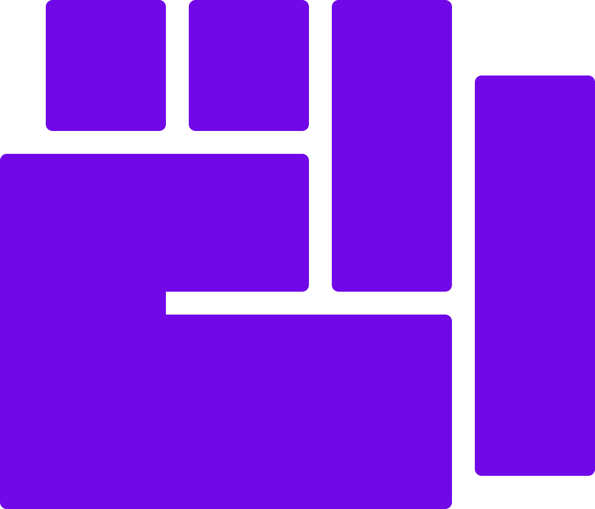

# StreamGrab
<p align="center">
  <strong>Save Audio & Video Without The Clutter.</strong><br>
  Aplikasi web modern berbasis Flask untuk mengonversi dan mengunduh video/audio YouTube (MP4 & MP3) secara instan, aman, dan tanpa iklan.
</p>

<p align="center">
  
</p>

---

## Fitur-Fitur

- **🎥 Multi-Format & Pilihan Kualitas**:
  - **MP4 (Video + Audio)**: Mendukung resolusi dari `360p`, `480p`, `720p (HD)`, hingga `1080p (Full HD)` atau *Max Quality* (Otomatis).
  - **MP3 (Audio Murni)**: Konversi audio berkualitas tinggi (`128kbps`, `192kbps`, hingga `320kbps`).
- **🔍 Live Video Preview**: Tampilan informasi instan (thumbnail, judul video, format, dan durasi) sebelum proses download dimulai.
- **📊 Real-time Progress Tracking**: Polling progres unduhan secara *live* di frontend (persentase, kecepatan unduh, ETA, dan status konversi).
- **🎨 Desain Neobrutalism Modern**: Tampilan visual bold dengan tipografi *Funnel Display*, animasi interaktif, serta *custom dropup* untuk pemilihan format & kualitas yang ramah pengguna di desktop maupun mobile.
- **🧹 Otomatis Membersihkan Storage**: File media dan job cache otomatis dihapus dari server setelah file selesai dikirim ke browser pengguna, menjaga server tetap hemat ruang penyimpanan.
- **⏱️ Proteksi Durasi Media**: Validasi batas durasi (`MAX_DURATION_SECONDS`, default: 20 menit) untuk menjaga kestabilan server dari beban download video berdurasi terlalu panjang.
- **🐳 Docker Ready**: Sudah dilengkapi konfigurasi Docker dan Docker Compose (termasuk FFmpeg bawaan) untuk kemudahan *deployment*.

---

## Tech Stack

- **Backend**: Python 3.12, [Flask](https://flask.palletsprojects.com/), [Gunicorn](https://gunicorn.org/)
- **Core Engine**: [yt-dlp](https://github.com/yt-dlp/yt-dlp), [FFmpeg](https://ffmpeg.org/) (untuk muxing video & ekstraksi audio)
- **Frontend**: HTML5, Vanilla JavaScript, CSS3 (Neobrutalism Theme), [Boxicons](https://boxicons.com/), Google Fonts (*Funnel Display*)
- **Containerization**: Docker & Docker Compose

---

## Prasyarat Sistem

Sebelum menjalankan StreamGrab, pastikan sistem Anda telah terpasang:

### Jika menggunakan Docker (Direkomendasikan):
- [Docker Desktop](https://www.docker.com/products/docker-desktop/) (Windows/macOS) atau Docker Engine + Docker Compose (Linux).

### Jika menjalankan secara Lokal (Tanpa Docker):
- **Python**: Versi 3.10 atau lebih baru (disarankan Python 3.12).
- **FFmpeg**: Wajib terpasang di sistem dan terdaftar pada Environment Variable `PATH` sistem Anda.
  - **Windows**: Download dari [gyan.dev](https://www.gyan.dev/ffmpeg/builds/) atau via Scoop/Winget (`winget install Gyan.FFmpeg`).
  - **macOS**: `brew install ffmpeg`
  - **Linux (Ubuntu/Debian)**: `sudo apt update && sudo apt install -y ffmpeg`

---

## Cara Menjalankan Project

### 1. Menggunakan Docker Compose (Paling Praktis)

Menjalankan dengan Docker adalah cara termudah karena dependensi seperti **Python** dan **FFmpeg** sudah terkonfigurasi otomatis di dalam container image.

1. **Clone repository & masuk ke direktori**:
   ```bash
   git clone https://github.com/username/streamgrab.git
   cd streamgrab
   ```

2. **Siapkan Environment Variables**:
   Salin template `.env.example` menjadi `.env`:
   ```bash
   # Windows (PowerShell / Command Prompt)
   copy .env.example .env

   # Linux / macOS
   cp .env.example .env
   ```
   *(Opsional: Anda dapat mengedit port atau batas durasi media di dalam file `.env`)*

3. **Build dan Jalankan Container**:
   ```bash
   docker compose up -d --build
   ```

4. **Akses Aplikasi**:
   Buka browser dan kunjungi:
   ```
   http://localhost:5000
   ```

5. **Perintah Tambahan Docker**:
   - Melihat log aplikasi secara *real-time*:
     ```bash
     docker compose logs -f
     ```
   - Menghentikan aplikasi:
     ```bash
     docker compose down
     ```

---

### 2. Menjalankan Secara Lokal (Python Virtual Environment)

1. **Clone repository & masuk ke direktori**:
   ```bash
   git clone https://github.com/dndyprd/streamgrab.git
   cd streamgrab
   ```

2. **Buat dan Aktifkan Virtual Environment**:
   - **Windows**:
     ```powershell
     python -m venv .venv
     .venv\Scripts\activate
     ```
   - **Linux / macOS**:
     ```bash
     python3 -m venv .venv
     source .venv/bin/activate
     ```

3. **Install Dependensi Python**:
   ```bash
   pip install --upgrade pip
   pip install -r requirements.txt
   ```

4. **Siapkan File `.env`**:
   ```bash
   copy .env.example .env   # Windows
   cp .env.example .env     # Linux / macOS
   ```

5. **Pastikan FFmpeg sudah terpasang**:
   ```bash
   ffmpeg -version
   ```

6. **Jalankan Aplikasi**:
   - **Mode Development (Flask bawaan)**:
     ```bash
     python app.py
     ```
   - **Mode Production (Gunicorn - Linux/macOS)**:
     ```bash
     gunicorn --bind 0.0.0.0:5000 --workers 2 --threads 4 --timeout 600 app:app
     ```

7. Buka browser dan akses **`http://localhost:5000`**.

---

## Konfigurasi Environment (`.env`)

Anda dapat menyesuaikan pengaturan berikut pada file `.env`:

| Variabel | Default | Deskripsi |
| :--- | :--- | :--- |
| `PORT` | `5000` | Port tempat web server berjalan |
| `MAX_DURATION_SECONDS` | `1200` | Batas maksimal durasi video yang diizinkan untuk dikonversi (1200 detik = 20 menit) |

---

## Struktur Direktori

```text
streamgrab/
├── app.py                 # Flask Server, Routing API, & Stream Response
├── downloader.py          # Wrapper yt-dlp, Job Manager, & Duration Validator
├── requirements.txt       # Daftar dependensi Python (Flask, Gunicorn, yt-dlp)
├── Dockerfile             # Konfigurasi container image (Python 3.12 + FFmpeg)
├── docker-compose.yml     # Konfigurasi orchestration Docker
├── .env.example           # Contoh variabel konfigurasi environment
├── .env                   # File variabel environment aktif (git-ignored)
├── downloads/             # Direktori sementara penyimpanan file unduhan
├── static/
│   ├── css/               # File CSS Neobrutalism & styling
│   └── images/            # Logo & aset gambar
└── templates/
    └── index.html         # Tampilan web utama
```

---

## Catatan & Batasan Penggunaan

- **YouTube Bot Verification**: Pastikan server/host memiliki koneksi internet yang stabil dan tidak diblokir oleh anti-bot YouTube.
- **Batas Durasi Video**: Konfigurasi `MAX_DURATION_SECONDS` disetel untuk menghindari pemakaian resource CPU/RAM berlebih pada instance server kecil.
- **Hak Cipta**: Gunakan aplikasi ini secara bijak dan hanya untuk media bebas hak cipta atau konten milik Anda sendiri sesuai ketentuan layanan platform terkait.

---

## Lisensi
Didistribusikan di bawah lisensi MIT. Silakan gunakan dan kembangkan sesuai kebutuhan Anda.
